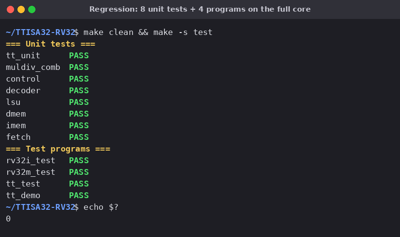
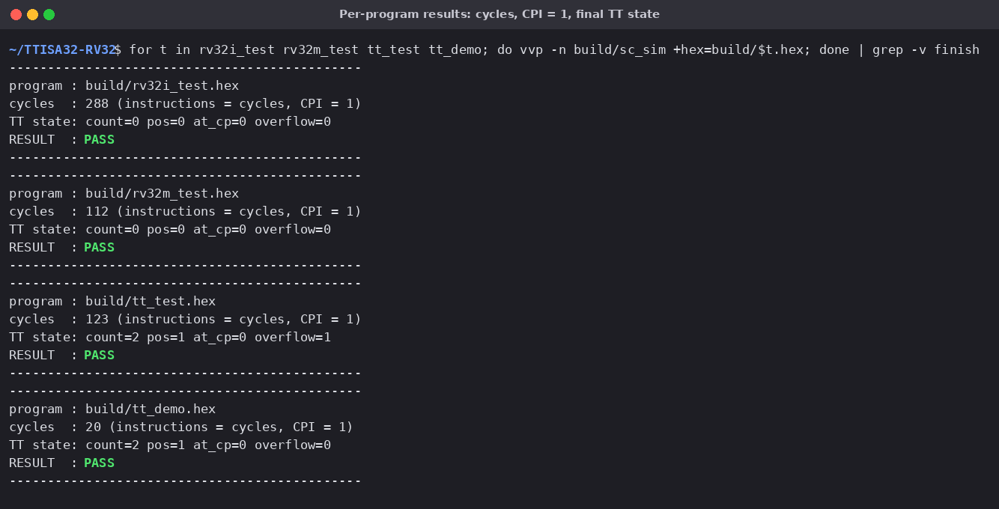
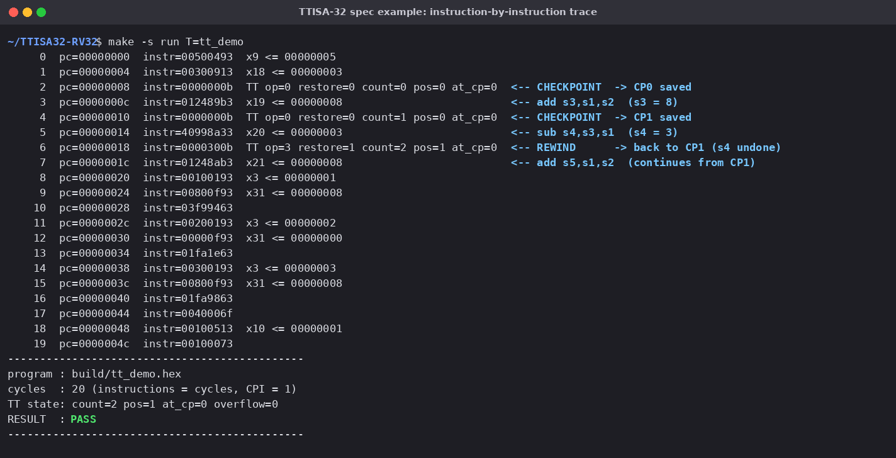
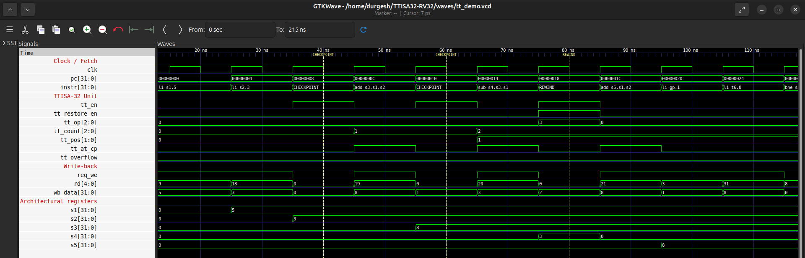
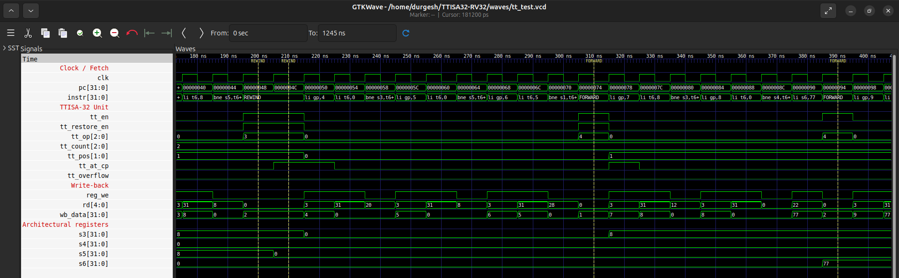
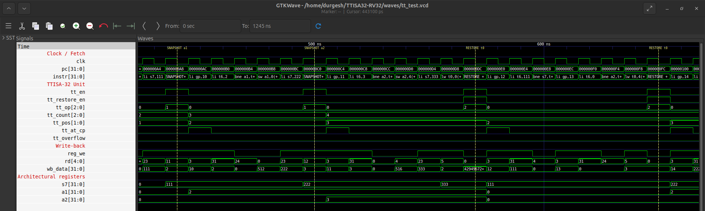
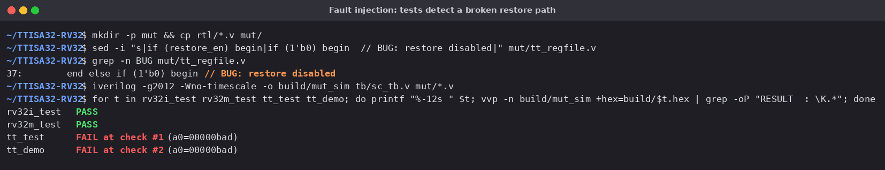

# Verification results

All tests run in Icarus Verilog. The waveforms are GTKWave screenshots of the VCD files.
Registers s1..s7, a1 and a2 map to R1..R5 of the spec example and to the handles used by
`tt_test.s`. They were exposed as plain wires for viewing, because Icarus does not dump the
register-file array.

## 1. Full regression

`make test` runs the 8 module-level testbenches and the 4 programs on the full core.
All 12 pass.

## 2. Per-program results

Each program ends with `EBREAK`, and the testbench prints its report. Every program runs at
CPI = 1: cycles equal retired instructions, including the TTISA-32 instructions.

| Program | Checks | Cycles | Covers |
|---|---|---|---|
| `rv32i_test` | 57 | 288 | every RV32I instruction |
| `rv32m_test` | 20 | 112 | MUL/MULH*/DIV*/REM*, incl. divide-by-zero and overflow |
| `tt_test`    | 26 | 123 | all 5 TTISA-32 instructions and edge cases |
| `tt_demo`    |  3 |  20 | the execution example from the spec |

## 3. Spec example, instruction by instruction

`make run T=tt_demo` prints one line per instruction. The TT unit state is shown on
TTISA-32 instructions, and register writes are shown as `xN <= value`.

- Cycle 2: `CHECKPOINT` saves CP0 (`count` 0 → 1).
- Cycle 4: `CHECKPOINT` saves CP1 (`count` 1 → 2, `pos` = 1).
- Cycle 5: `sub s4, s3, s1` writes s4 = 3.
- Cycle 6: `REWIND` (`op=3`, `restore=1`) restores CP1, so s4 goes back to 0 and s3 = 8 is kept.
- Cycle 7: execution continues from CP1 (`add s5, s1, s2`).

## 4. Waveform: CHECKPOINT / REWIND (spec example)

The dashed markers are placed on each TTISA-32 instruction. At the `REWIND` marker,
`tt_restore_en` goes high for one cycle. On the next clock edge **s4 drops from 3 to 0**
while s3 stays at 8. All 31 registers are restored in a single cycle.

## 5. Waveform: double REWIND and FORWARD (`tt_test`)

- First `REWIND`: back to CP1, s5 = 8 is undone.
- Second `REWIND`: the core is already at CP1 (`tt_at_cp` = 1), so it moves back to CP0 and
  s3 becomes 0 (`pos` 1 → 0).
- First `FORWARD`: moves to CP1, s3 = 8 again (`pos` 0 → 1).
- Second `FORWARD`: CP1 is the newest checkpoint, so it is a no-op (`restore_en` stays 0)
  and s6 = 77 is kept.

## 6. Waveform: SNAPSHOT / RESTORE with handles (`tt_test`)

- `SNAPSHOT a1` saves slot 2 and writes handle 2 to a1. `SNAPSHOT a2` saves slot 3 and
  writes handle 3 to a2.
- The handles are stored to memory and loaded back into t0.
- `RESTORE t0` (handle 2) sets s7 back to 111 and a2 back to 0, because a2 had not been
  written yet when slot 2 was saved.
- `RESTORE t0` (handle 3) sets s7 back to 222 and a1 back to 2. A restore does not discard
  later checkpoints.

## 7. Fault injection: the tests detect bugs

To show that the tests can fail, the register-file restore path was disabled in a copy of
the RTL (`if (restore_en)` → `if (1'b0)`). The RV32I and RV32M programs still pass. Both
TTISA-32 programs fail at the first check that depends on a restore.

